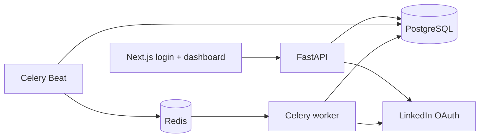

# LinkedIn Post Scheduler

A working application that connects a LinkedIn member, stores a scheduled text or image post, and publishes
it through a durable background worker at the requested time.



## Run locally

Start the backend infrastructure:

```bash
cd backend
cp .env.example .env
# Configure TOKEN_ENCRYPTION_KEY and LinkedIn credentials, or enable LINKEDIN_MOCK_MODE.
docker compose up --build
```

Start the frontend in another terminal:

```bash
cd frontend
cp .env.example .env.local
npm install
npm run dev
```

Open `http://localhost:3000/login`.

See [backend/README.md](backend/README.md) for the database schema, OAuth configuration, retry and
duplicate-protection behavior, API reference, logging, and detailed setup. See
[frontend/README.md](frontend/README.md) for frontend commands and architecture.

To configure real LinkedIn credentials, follow the dedicated
[LinkedIn Developer App setup guide](backend/LINKEDIN_SETUP.md).

