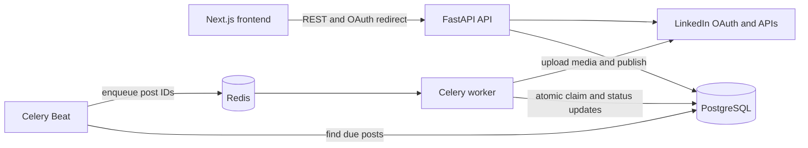

# LinkedIn Post Scheduler

A full-stack application for composing, publishing, scheduling, and monitoring LinkedIn posts. It
supports text posts, one optional image, immediate publishing, future scheduling, retry handling,
OAuth connection management, and a LinkedIn-style post preview.

This repository contains both applications:

- `frontend/` — Next.js dashboard and login experience.
- `backend/` — FastAPI API, PostgreSQL persistence, Redis, Celery worker, and scheduler.

## Application screencast

[▶ Watch the complete application demo][Screencast from 2026-10-21 14-20-17.webm](https://github.com/user-attachments/assets/c7836df9-ca50-4886-a569-878137e22eb9)


The screencast demonstrates the frontend dashboard, LinkedIn connection state, post composer,
immediate and scheduled publishing options, activity timeline, and LinkedIn-style post preview.

## Features

- Connect a LinkedIn member with OAuth 2.0/OpenID Connect.
- Use a mock LinkedIn connection for local demonstrations.
- Publish immediately or schedule for a future local date and time.
- Prevent selection of past scheduling dates.
- Write posts up to 3,000 characters.
- Attach one JPEG, PNG, or GIF image up to 5 MB.
- Preview saved posts in a LinkedIn-style modal.
- Monitor `scheduled`, `processing`, `published`, and `failed` states.
- Retry temporary LinkedIn and network failures with exponential backoff.
- Protect create requests with an application idempotency key.
- Encrypt LinkedIn access and refresh tokens before database storage.

## System architecture



The API stores a post before it is published. Celery Beat periodically finds due records and sends
their identifiers to Redis. A worker atomically claims each record, decrypts the connection token,
publishes through LinkedIn, and persists the result. The database is the source of truth for status,
retry timing, and duplicate protection.

## Repository structure

```text
.
├── README.md                  # Whole-project documentation
├── .gitignore
├── frontend/
│   ├── src/
│   │   ├── @core/            # Reusable form controls
│   │   ├── api/              # Endpoints, Axios functions, and React Query hooks
│   │   ├── app/              # Next.js routes, layout, providers, and global styles
│   │   ├── module/
│   │   │   ├── auth/         # Login page and local browser session helper
│   │   │   └── dashboard/    # Connection, composer, activity list, and preview modal
│   │   └── types/            # API request and response types
│   ├── .env.example
│   ├── package.json
│   └── README.md
└── backend/
    ├── app/
    │   ├── api/              # FastAPI routers
    │   ├── core/             # Settings, encryption, and structured logging
    │   ├── db/               # SQLAlchemy engine and sessions
    │   ├── models/           # Database models
    │   ├── schemas/          # Pydantic request and response schemas
    │   ├── services/         # Posting rules and LinkedIn client
    │   └── workers/          # Celery application and publishing tasks
    ├── alembic/              # Database migration environment and revisions
    ├── tests/                # Backend unit and service tests
    ├── docker-compose.yml
    ├── pyproject.toml
    └── README.md
```

For file-by-file explanations, see [Frontend documentation](frontend/README.md) and
[Backend documentation](backend/README.md).

## Technology stack

The versions below are taken from `frontend/package-lock.json`, `backend/pyproject.toml`, the backend
Dockerfile, and Docker Compose. Frontend packages declared with a caret range in `package.json` are
shown at the exact version currently locked by npm.

### Frontend runtime packages

| Package | Version | How it is used |
|---|---:|---|
| `next` | `15.5.28` | App Router framework, route rendering, production bundling, font optimization, and application metadata. |
| `react` | `19.2.0` | Component model, state, effects, refs, and client-side interaction. |
| `react-dom` | `19.2.0` | Connects React components to the browser DOM. |
| `@mui/material` | `7.3.11` | Buttons, dialogs, inputs, chips, alerts, typography, progress indicators, layout primitives, and the application theme. |
| `@mui/icons-material` | `7.3.11` | LinkedIn, scheduling, upload, status, navigation, and post-action icons. |
| `@emotion/react` | `11.14.0` | Runtime CSS-in-JS engine required by Material UI. |
| `@emotion/styled` | `11.14.1` | Styled-component support used internally by Material UI. |
| `@tanstack/react-query` | `5.104.5` | Connection/post queries, five-second activity polling, mutations, cache invalidation, and loading states. |
| `axios` | `1.20.0` | HTTP client with a shared API base URL, timeout, typed responses, and centralized error handling. |
| `react-hook-form` | `7.90.0` | Form state, field controllers, submission handling, and error display for the post composer. |
| `@hookform/resolvers` | `5.9.2` | Connects the Zod validation schema to React Hook Form. |
| `zod` | `3.25.76` | Validates content, publish mode, future schedule time, and retry-attempt input. |
| `react-hot-toast` | `2.6.1` | Success and error notifications for connection and publishing operations. |

The application also uses custom responsive CSS from `frontend/src/app/styles.css`; no utility-CSS
framework is included.

### Frontend development packages

| Package | Version | How it is used |
|---|---:|---|
| `typescript` | `5.9.3` | Static typing for components, forms, API payloads, and responses. |
| `eslint` | `9.39.5` | JavaScript and TypeScript linting. |
| `eslint-config-next` | `15.5.28` | Next.js and React-specific ESLint rules. |
| `prettier` | `3.9.10` | Consistent source and Markdown formatting. |
| `@types/node` | `22.20.5` | Node.js type declarations used by Next.js and configuration files. |
| `@types/react` | `19.2.2` | React type declarations. |
| `@types/react-dom` | `19.2.2` | React DOM type declarations. |

### Backend runtime packages

Backend dependencies are pinned to exact versions in `backend/pyproject.toml`.

| Package | Version | How it is used |
|---|---:|---|
| `fastapi` | `0.115.11` | REST API routing, dependency injection, validation integration, CORS, response handling, and OpenAPI documentation. |
| `uvicorn[standard]` | `0.34.0` | ASGI production/development server with the standard performance extras. |
| `pydantic` | `2.10.6` | Request/response schemas and post validation. |
| `pydantic-settings` | `2.8.1` | Typed environment-variable and `.env` configuration. |
| `sqlalchemy` | `2.0.39` | ORM models, sessions, queries, transactions, indexes, and atomic worker state transitions. |
| `psycopg[binary]` | `3.2.6` | PostgreSQL driver used by SQLAlchemy without requiring a local compiler build. |
| `alembic` | `1.14.1` | Versioned PostgreSQL schema migrations. |
| `celery[redis]` | `5.4.0` | Background publishing tasks, the Redis transport, retry scheduling, and Celery Beat. |
| `httpx` | `0.28.1` | LinkedIn OAuth, profile, image-upload, and post-publishing HTTP requests. |
| `cryptography` | `44.0.2` | Fernet encryption and decryption of stored LinkedIn tokens. |
| `python-json-logger` | `3.2.1` | Structured JSON logs for API and worker processes. |
| `anyio` | `4.8.0` | Async compatibility layer used by the FastAPI/Starlette runtime. |

### Backend development packages

| Package | Version | How it is used |
|---|---:|---|
| `pytest` | `8.3.5` | Automated unit and service tests. |
| `pytest-cov` | `6.0.0` | Test coverage reporting for the `app` package. |
| `ruff` | `0.11.2` | Python linting, import sorting, and formatting checks. |

### Runtime infrastructure and external APIs

| Technology | Version | Responsibility |
|---|---:|---|
| Python | `3.12` (`python:3.12-slim`) | Backend runtime used by the API, migrations, worker, and scheduler containers. |
| PostgreSQL | `17` (`postgres:17-alpine`) | Durable storage for connections, encrypted tokens, OAuth state, images, schedules, attempts, and results. |
| Redis | `7.4` (`redis:7.4-alpine`) | Celery broker and result backend with append-only persistence enabled. |
| LinkedIn REST API | `202609` by default | OAuth profile lookup, image initialization/upload, and post publishing. The version is configurable with `LINKEDIN_API_VERSION`. |
| OAuth 2.0/OIDC | LinkedIn-managed | Authorization-code login, member identity, and delegated `w_member_social` publishing access. |

### Why this combination

- Next.js and Material UI provide a typed, responsive dashboard without requiring a separate UI
  component system.
- React Query separates remote server state from form state and keeps publishing activity current.
- React Hook Form plus Zod provides browser feedback while the backend repeats all security-relevant
  validation.
- FastAPI and Pydantic provide typed request handling and generated API documentation.
- PostgreSQL keeps scheduling, retries, and publishing outcomes durable across process restarts.
- Redis and Celery keep slow LinkedIn calls outside API requests, while Celery Beat finds due work.
- SQLAlchemy's conditional update is the final concurrency gate, making duplicate queue deliveries
  safe.

## Prerequisites

- Node.js 20 or newer and npm.
- Docker with Docker Compose for the recommended backend setup.
- Python 3.12+, PostgreSQL, and Redis if running the backend without Docker.
- A LinkedIn Developer application for real publishing. Mock mode does not require one.

## Quick start

### 1. Configure and start the backend

```bash
cd backend
cp .env.example .env
```

Generate a Fernet key:

```bash
python -c "from cryptography.fernet import Fernet; print(Fernet.generate_key().decode())"
```

Put the result in `backend/.env` as `TOKEN_ENCRYPTION_KEY`. For a local demo, also set:

```dotenv
LINKEDIN_MOCK_MODE=true
```

Start PostgreSQL, Redis, migrations, API, worker, and scheduler:

```bash
docker compose up --build
```

The API is available at `http://localhost:8000`, and Swagger documentation is available at
`http://localhost:8000/docs`.

### 2. Configure and start the frontend

In a second terminal:

```bash
cd frontend
cp .env.example .env.local
npm install
npm run dev
```

Open `http://localhost:3000/login`. Select **Use demo connection** when mock mode is enabled, or
select **Continue with LinkedIn** after configuring real LinkedIn credentials.

## Main application flow

1. The user connects a real or mock LinkedIn account.
2. The dashboard loads connection metadata and the latest posts.
3. The user writes content and optionally selects an image.
4. **Post now** sends the current timestamp; **Schedule post** sends the selected future timestamp.
5. The API validates and stores the post with status `scheduled`.
6. Celery Beat detects the due record and enqueues its ID.
7. A worker atomically changes its status to `processing` and publishes it.
8. The record becomes `published`, returns to `scheduled` for a retry, or becomes `failed`.
9. The frontend refreshes activity automatically and exposes a detailed post-preview modal.

## Development commands

Frontend:

```bash
cd frontend
npm run dev
npm run typecheck
npm run lint
npm run format:check
npm run build
```

Backend:

```bash
cd backend
make install
make migrate
make run
make worker
make scheduler
make lint
make test
```

## Configuration summary

The frontend uses `NEXT_PUBLIC_API_BASE_URL` to locate the API. The backend configuration includes
database and Redis URLs, frontend/CORS origins, LinkedIn credentials, the API version, and the token
encryption key. Detailed variable tables are in the application-specific READMEs.

Do not commit `.env`, `.env.local`, encryption keys, access tokens, or LinkedIn client secrets.

## Security and reliability notes

- OAuth state values are random, stored only as SHA-256 hashes, expire, and are single-use.
- LinkedIn tokens are encrypted with Fernet before being stored.
- Create requests require an `Idempotency-Key` UUID.
- Duplicate queue delivery is handled with an atomic database status transition.
- Temporary `429` and `5xx` responses use durable retry scheduling.
- Ambiguous publishing timeouts are failed for manual review to avoid accidental duplicate posts.
- The frontend local-storage session is a navigation convenience, not a production authentication
  boundary. Add authenticated backend authorization before exposing this application publicly.

## Production checklist

- Use HTTPS for both applications and update OAuth redirect URLs.
- Disable mock mode.
- Store secrets in a managed secrets service.
- Use managed PostgreSQL and Redis with backups and restricted access.
- Set the correct frontend URL and CORS origins.
- Run API, worker, and scheduler as separate supervised services.
- Apply Alembic migrations during deployment.
- Add backend authentication and resource ownership checks.
- Add monitoring for failed/stale posts, queue depth, and token expiration.
- Review the configured LinkedIn API version before it is sunset.

## Additional documentation

- [Frontend README](frontend/README.md)
- [Backend README](backend/README.md)
- [LinkedIn Developer application setup](backend/LINKEDIN_SETUP.md)

## Create and push a fresh repository

Create an empty repository named `linkedin-post-scheduler` on GitHub without adding a generated
README, license, or `.gitignore`. Then run these commands from this project root:

```bash
git init
git add .
git commit -m "Initial commit"
git branch -M main
git remote add origin https://github.com/<your-username>/linkedin-post-scheduler.git
git push -u origin main
```

Before committing, review `git status` and confirm that `.env`, `.env.local`, `.agents`, `.aws`,
`.codex`, virtual environments, dependencies, and build output are not staged. The root `.gitignore`
already excludes these paths.

No public deployment is included. The repository is designed to run locally in mock mode or to be
configured with your own infrastructure and LinkedIn Developer application.
