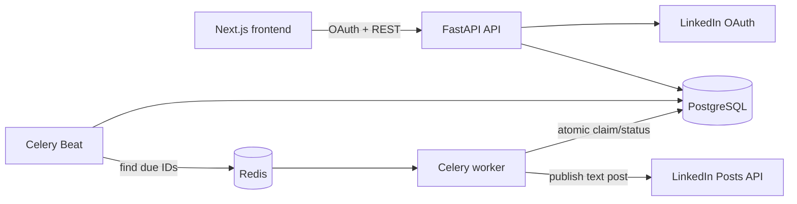

# LinkedIn Post Scheduler — Backend

FastAPI, PostgreSQL, Redis, Celery worker, and Celery Beat provide a durable scheduled-publishing
pipeline. The backend exposes OpenAPI docs at `http://localhost:8000/docs`.

## Architecture



The scheduler only enqueues identifiers. A worker atomically changes `scheduled` to `processing`,
which makes duplicate queue deliveries harmless. A successful LinkedIn URN is unique in the
database. Temporary HTTP responses (`429` and `5xx`) return the record to `scheduled` with a durable
exponential delay. Permanent failures move it to `failed`.

A scheduled post may include one JPEG, PNG, or GIF image up to 5 MB. The worker initializes a
LinkedIn image upload, uploads the stored bytes, and attaches the returned Image URN to the post.

A response timeout is an ambiguous result: LinkedIn might have accepted the post even though the
worker did not receive the response. It is marked `failed` for manual reconciliation rather than
automatically retried. This is the only safe behavior because LinkedIn's documented Posts API does
not promise a client idempotency contract. The stable application idempotency key is still sent for
traceability.

## Quick start with Docker

1. Create the environment file and encryption key:

   ```bash
   cp .env.example .env
   python -c "from cryptography.fernet import Fernet; print(Fernet.generate_key().decode())"
   ```

2. Put the generated value in `TOKEN_ENCRYPTION_KEY`.
3. For a no-credentials local demo, set `LINKEDIN_MOCK_MODE=true` in `.env`. For real publishing,
   configure the LinkedIn values described below.
4. Start all services:

   ```bash
   docker compose up --build
   ```

5. Open `http://localhost:8000/docs`. The health check is `GET /api/v1/health`.

For mock mode, first call `POST /api/v1/connections/mock`. Then create a post with its returned
connection ID and a stable UUID in the `Idempotency-Key` header.

```bash
curl -X POST http://localhost:8000/api/v1/posts \
  -H 'Content-Type: application/json' \
  -H 'Idempotency-Key: 0d3ae35a-8a4e-46e0-a1f4-67afdf4b3495' \
  -d '{
    "connection_id": "REPLACE_WITH_CONNECTION_ID",
    "content": "Scheduled from FastAPI",
    "scheduled_at": "2026-10-21T10:00:00+05:30",
    "max_attempts": 5
  }'
```

## Real LinkedIn setup

For a complete click-by-click guide with official links, see
[LINKEDIN_SETUP.md](LINKEDIN_SETUP.md).

1. Create a LinkedIn Developer application and add **Sign In with LinkedIn using OpenID Connect**
   and **Share on LinkedIn**.
2. Add this exact authorized redirect URL:
   `http://localhost:8000/api/v1/auth/linkedin/callback` (use HTTPS in production).
3. Set `LINKEDIN_CLIENT_ID`, `LINKEDIN_CLIENT_SECRET`, and `LINKEDIN_REDIRECT_URI` in `.env`.
4. Keep `LINKEDIN_MOCK_MODE=false`.
5. Visit `http://localhost:8000/api/v1/auth/linkedin/authorize` in a browser.

The flow requests `openid profile w_member_social`. OAuth CSRF state is random, stored only as a
SHA-256 hash, expires after ten minutes, and can be used once. Access and refresh tokens are
encrypted with Fernet before entering PostgreSQL. Client secrets and encryption keys stay in the
environment and must be supplied by a secrets manager in production.

The current LinkedIn marketing version is configurable through `LINKEDIN_API_VERSION`, because
LinkedIn versions its Posts API monthly and sunsets old versions.

## Local development without Docker for the API

Python 3.12+, PostgreSQL, and Redis are required.

```bash
python -m venv .venv
source .venv/bin/activate
pip install -e '.[dev]'
cp .env.example .env
alembic upgrade head
uvicorn app.main:app --reload
```

Run the worker and scheduler in separate terminals:

```bash
celery -A app.workers.celery_app:celery_app worker -Q linkedin-publishing --loglevel=INFO
celery -A app.workers.celery_app:celery_app beat --loglevel=INFO
```

Quality checks:

```bash
ruff check .
ruff format --check .
pytest --cov=app --cov-report=term-missing
```

## API summary

| Method | Endpoint | Purpose |
|---|---|---|
| GET | `/api/v1/auth/linkedin/authorize` | Start LinkedIn OAuth |
| GET | `/api/v1/auth/linkedin/callback` | Validate state and save encrypted token |
| GET | `/api/v1/connections` | List connection metadata (never tokens) |
| POST | `/api/v1/connections/mock` | Create a local-only demo connection |
| POST | `/api/v1/posts` | Schedule a post; requires `Idempotency-Key` UUID |
| GET | `/api/v1/posts` | List posts, optionally filtered by status |
| GET | `/api/v1/posts/{id}` | Read current status and error details |

Valid statuses are `scheduled`, `processing`, `published`, and `failed`. All dates are stored in UTC;
API input must include an explicit timezone offset.

## Database schema

```text
linkedin_connections
  id UUID PK
  linkedin_member_id VARCHAR UNIQUE
  display_name VARCHAR NULL
  access_token_encrypted TEXT
  refresh_token_encrypted TEXT NULL
  token_expires_at TIMESTAMPTZ
  refresh_token_expires_at TIMESTAMPTZ NULL
  scopes TEXT
  created_at / updated_at TIMESTAMPTZ

oauth_states
  id UUID PK
  state_hash CHAR(64) UNIQUE
  expires_at / used_at / created_at TIMESTAMPTZ

scheduled_posts
  id UUID PK
  connection_id UUID FK -> linkedin_connections.id
  content TEXT
  image_data BYTEA NULL
  image_content_type / image_filename VARCHAR NULL
  scheduled_at / next_attempt_at TIMESTAMPTZ
  status VARCHAR(20)
  attempt_count / max_attempts INTEGER
  idempotency_key UUID UNIQUE
  linkedin_post_urn VARCHAR UNIQUE NULL
  last_error TEXT NULL
  processing_started_at / published_at TIMESTAMPTZ NULL
  created_at / updated_at TIMESTAMPTZ
  INDEX (status, next_attempt_at)
```

The source-of-truth schema is the Alembic migration in `alembic/versions/`.

## Operational notes

- JSON logs include request IDs, post IDs, attempts, and outcomes; credentials and post content are
  intentionally excluded.
- Celery uses late acknowledgements and one-message prefetch. Database claiming remains the final
  concurrency guard.
- A stale `processing` record is failed for manual review, not republished.
- Token refresh fields are stored when LinkedIn supplies them. If no refresh token is available,
  an expired connection must complete OAuth again.
- Production should use HTTPS, managed PostgreSQL/Redis, a secrets manager, encrypted backups,
  monitoring, and restricted network access.

## Live demo

No public deployment is included in this repository. `LINKEDIN_MOCK_MODE=true` provides a complete
local demonstration without publishing to a real LinkedIn account.
