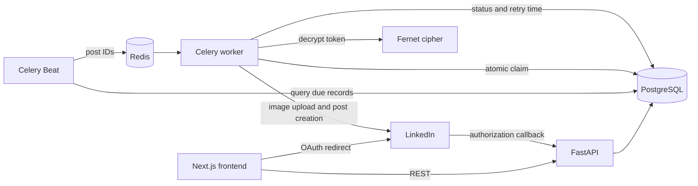
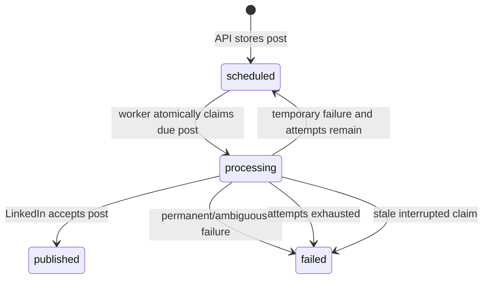

# LinkedIn Post Scheduler — Backend

The backend is a FastAPI service with a durable publishing pipeline built on PostgreSQL, Redis,
Celery, and Celery Beat. It manages LinkedIn OAuth, encrypted tokens, scheduled records, image
uploads, background publishing, retries, and delivery status.

Interactive API documentation is available at `http://localhost:8000/docs` while the API is running.

## Architecture



The scheduler enqueues only post identifiers. The worker reloads state from PostgreSQL and atomically
changes a due record from `scheduled` to `processing`. If duplicate queue messages arrive, only one
can claim the record; the others return without publishing.

## Features

- LinkedIn OAuth authorization-code flow with OpenID Connect profile lookup.
- Hashed, expiring, single-use OAuth state records.
- Fernet-encrypted access and refresh tokens.
- Mock mode for a complete local workflow without LinkedIn credentials.
- Immediate and future post scheduling.
- Text posts and one optional JPEG, PNG, or GIF image up to 5 MB.
- Durable status and attempt tracking in PostgreSQL.
- Redis-backed Celery task delivery.
- Exponential retry for temporary failures and `Retry-After` support.
- Atomic worker claiming and create-request idempotency.
- Structured JSON application logging.
- Alembic migrations and automated tests.

## Directory structure

```text
backend/
├── app/
│   ├── api/
│   │   ├── router.py                 # Combines all route groups
│   │   └── routes/
│   │       ├── auth.py               # LinkedIn authorization and callback
│   │       ├── connections.py        # Connection listing and mock creation
│   │       ├── health.py             # Health endpoint
│   │       └── posts.py              # Create/list/read posts and return media
│   ├── core/
│   │   ├── config.py                 # Pydantic settings and secret checks
│   │   ├── logging.py                # JSON logging configuration
│   │   └── security.py               # Token encryption and OAuth-state helpers
│   ├── db/
│   │   ├── base.py                   # SQLAlchemy declarative base/model imports
│   │   └── session.py                # Engine, session factory, dependency
│   ├── models/
│   │   ├── linkedin_connection.py
│   │   ├── oauth_state.py
│   │   └── scheduled_post.py
│   ├── schemas/
│   │   ├── connection.py             # Public connection response
│   │   └── post.py                   # Post validation and response
│   ├── services/
│   │   ├── exceptions.py             # Temporary/permanent LinkedIn errors
│   │   ├── linkedin.py               # OAuth, profile, upload, and publish client
│   │   └── posts.py                  # Persistence and idempotency rules
│   ├── workers/
│   │   ├── celery_app.py             # Broker, queue, Beat schedule, task settings
│   │   └── tasks.py                  # Due-post dispatch and publishing task
│   └── main.py                        # FastAPI app, CORS, logging, middleware
├── alembic/
│   ├── env.py
│   └── versions/                      # Versioned database changes
├── tests/                             # Pytest test suite
├── .env.example
├── alembic.ini
├── docker-compose.yml
├── Dockerfile
├── LINKEDIN_SETUP.md
├── Makefile
└── pyproject.toml
```

## Prerequisites

Recommended:

- Docker and Docker Compose.

For a manual installation:

- Python 3.12 or newer.
- PostgreSQL.
- Redis.
- A C compiler may be needed if a dependency wheel is unavailable for the platform.

## Environment configuration

Create the environment file:

```bash
cp .env.example .env
```

Generate the required Fernet encryption key:

```bash
python -c "from cryptography.fernet import Fernet; print(Fernet.generate_key().decode())"
```

### Core variables

| Variable | Default/example | Description |
|---|---|---|
| `APP_ENV` | `development` | Environment label. |
| `LOG_LEVEL` | `INFO` | Python root log level. |
| `DATABASE_URL` | `postgresql+psycopg://...` | SQLAlchemy database URL. |
| `REDIS_URL` | `redis://redis:6379/0` | Celery broker and result-backend URL. |
| `FRONTEND_URL` | `http://localhost:3000` | OAuth success redirect destination. |
| `CORS_ORIGINS` | `["http://localhost:3000"]` | Allowed browser origins as JSON or comma-separated text. |
| `TOKEN_ENCRYPTION_KEY` | No safe default | Fernet key used to encrypt LinkedIn tokens. |

### LinkedIn variables

| Variable | Default/example | Description |
|---|---|---|
| `LINKEDIN_CLIENT_ID` | `replace-me` | LinkedIn Developer application client ID. |
| `LINKEDIN_CLIENT_SECRET` | `replace-me` | LinkedIn Developer application secret. |
| `LINKEDIN_REDIRECT_URI` | `http://localhost:8000/api/v1/auth/linkedin/callback` | Exact registered OAuth callback. |
| `LINKEDIN_API_VERSION` | `202609` | Monthly LinkedIn REST API version header. |
| `LINKEDIN_MOCK_MODE` | `false` | Bypass external publishing and return deterministic mock URNs. |

### Worker and reliability variables

These have defaults in `app/core/config.py` and can be added to `.env` when tuning is required.

| Variable | Default | Description |
|---|---:|---|
| `SCHEDULER_INTERVAL_SECONDS` | `15` | Frequency at which Beat looks for due posts. |
| `OAUTH_STATE_TTL_MINUTES` | `10` | Validity period for an unused OAuth state. |
| `PUBLISH_TIMEOUT_SECONDS` | `20` | Timeout for LinkedIn HTTP operations. |
| `RETRY_BASE_DELAY_SECONDS` | `60` | Initial exponential retry delay. |
| `RETRY_MAX_DELAY_SECONDS` | `3600` | Maximum exponential retry delay. |
| `PROCESSING_TIMEOUT_MINUTES` | `10` | Age at which an interrupted processing claim is failed. |

Never commit `.env`, client secrets, encryption keys, database credentials, or access tokens.

## Quick start with Docker

For a credential-free local demo, set these values in `.env`:

```dotenv
LINKEDIN_MOCK_MODE=true
TOKEN_ENCRYPTION_KEY=REPLACE_WITH_GENERATED_FERNET_KEY
```

Start all backend services:

```bash
docker compose up --build
```

Docker Compose starts:

| Service | Responsibility |
|---|---|
| `db` | PostgreSQL 17 with persistent `postgres_data`. |
| `redis` | Redis 7.4 with append-only persistence in `redis_data`. |
| `migrate` | Runs `alembic upgrade head` once PostgreSQL is healthy. |
| `api` | Serves FastAPI on host port `8000`. |
| `worker` | Consumes the `linkedin-publishing` queue. |
| `scheduler` | Runs Celery Beat and dispatches due posts. |

Useful commands:

```bash
docker compose ps
docker compose logs -f api worker scheduler
docker compose down
docker compose down -v  # Also deletes local database and Redis volumes.
```

The final command is destructive and should only be used when local data is no longer needed.

## Manual local development

Configure `DATABASE_URL` for a locally reachable PostgreSQL instance and `REDIS_URL` for Redis.
Then run:

```bash
python -m venv .venv
source .venv/bin/activate
pip install -e '.[dev]'
cp .env.example .env
alembic upgrade head
uvicorn app.main:app --reload
```

Start the worker and scheduler in two additional terminals with the same virtual environment:

```bash
celery -A app.workers.celery_app:celery_app worker \
  -Q linkedin-publishing --loglevel=INFO
```

```bash
celery -A app.workers.celery_app:celery_app beat --loglevel=INFO
```

Equivalent shortcuts are available in the `Makefile`: `make install`, `make migrate`, `make run`,
`make worker`, `make scheduler`, `make up`, and `make down`.

## Real LinkedIn configuration

See [LINKEDIN_SETUP.md](LINKEDIN_SETUP.md) for detailed LinkedIn Developer Portal instructions.

At a high level:

1. Create a LinkedIn Developer application.
2. Enable **Sign In with LinkedIn using OpenID Connect** and **Share on LinkedIn**.
3. Register the exact backend callback URL.
4. Configure `LINKEDIN_CLIENT_ID`, `LINKEDIN_CLIENT_SECRET`, and `LINKEDIN_REDIRECT_URI`.
5. Set `LINKEDIN_MOCK_MODE=false`.
6. Start OAuth at `GET /api/v1/auth/linkedin/authorize`.

The requested scopes are `openid`, `profile`, and `w_member_social`.

## API reference

All routes are prefixed with `/api/v1` except that the health router itself determines its final
health path. Swagger at `/docs` is the authoritative runtime reference.

| Method | Endpoint | Description |
|---|---|---|
| GET | `/api/v1/health` | Return API health. |
| GET | `/api/v1/auth/linkedin/authorize` | Create OAuth state and redirect to LinkedIn. |
| GET | `/api/v1/auth/linkedin/callback` | Consume state, exchange code, save connection, and redirect. |
| GET | `/api/v1/connections` | List connection metadata; encrypted tokens are never returned. |
| POST | `/api/v1/connections/mock` | Create/reuse a demo connection; available only in mock mode. |
| POST | `/api/v1/posts` | Validate and store a post. Requires an `Idempotency-Key` UUID header. |
| GET | `/api/v1/posts` | List newest posts with optional `status` and `limit` query parameters. |
| GET | `/api/v1/posts/{post_id}` | Return one post record. |
| GET | `/api/v1/posts/{post_id}/image` | Return the stored image bytes with their media type. |

### Create-post request

```http
POST /api/v1/posts
Content-Type: application/json
Idempotency-Key: 0d3ae35a-8a4e-46e0-a1f4-67afdf4b3495
```

```json
{
  "connection_id": "REPLACE_WITH_CONNECTION_ID",
  "content": "A scheduled update from the API.",
  "scheduled_at": "2026-10-21T15:30:00+05:30",
  "max_attempts": 5,
  "image_base64": null,
  "image_content_type": null,
  "image_filename": null
}
```

Rules:

- `content` is trimmed and must contain 1–3,000 characters.
- `scheduled_at` must contain a timezone offset and is normalized to UTC.
- `max_attempts` must be from 1 through 10.
- Image fields must be omitted/null together or supplied together.
- Image content must be valid base64, one of the supported MIME types, and no larger than 5 MB.
- A timestamp at or before the current time represents a post that is due immediately.

Example with cURL:

```bash
curl -X POST http://localhost:8000/api/v1/posts \
  -H 'Content-Type: application/json' \
  -H 'Idempotency-Key: 0d3ae35a-8a4e-46e0-a1f4-67afdf4b3495' \
  -d '{
    "connection_id": "REPLACE_WITH_CONNECTION_ID",
    "content": "Scheduled from FastAPI",
    "scheduled_at": "2026-10-21T15:30:00+05:30",
    "max_attempts": 5
  }'
```

### List-post query parameters

| Parameter | Values | Default | Description |
|---|---|---:|---|
| `status` | `scheduled`, `processing`, `published`, `failed` | All | Filter by status. |
| `limit` | `1`–`100` | `50` | Maximum records returned. |

## Publishing lifecycle



### Dispatch

Every `SCHEDULER_INTERVAL_SECONDS`, `dispatch_due_posts`:

1. Marks stale `processing` records as failed for manual reconciliation.
2. Selects up to 100 `scheduled` records whose `next_attempt_at` is due.
3. Sends one `publish_post` task per ID to the `linkedin-publishing` queue.

### Worker claim

`publish_post` uses a conditional SQL update requiring both `scheduled` status and a due
`next_attempt_at`. This transition is the final concurrency gate. A duplicate message that cannot
claim the record returns `skipped`.

### Retry policy

Connection errors, `429`, and `5xx` responses are temporary. The next delay is:

```text
max(min(base_delay × 2^(attempt - 1), maximum_delay), Retry-After)
```

The record returns to `scheduled` until `max_attempts` is reached. Validation failures and other
permanent LinkedIn responses move directly to `failed`.

A response timeout after a publish request is ambiguous: LinkedIn may have accepted the post even
though no response arrived. The worker fails it for manual reconciliation rather than risking an
automatic duplicate.

## Idempotency behavior

`POST /posts` requires a caller-generated UUID. Repeating the same request with the same key returns
the existing record. Reusing a key for conflicting post content, connection, image, or schedule
returns HTTP `409`.

This database guarantee protects API retries. The key is also sent to LinkedIn for traceability, but
the worker does not assume LinkedIn provides a complete client-side idempotency guarantee.

## Image publishing

Image posts use LinkedIn's two-stage process:

1. Initialize an image upload and obtain an upload URL plus Image URN.
2. Upload the raw bytes to that URL.
3. Attach the Image URN to the Posts API request.

Original bytes are stored in `scheduled_posts.image_data`. The image endpoint returns them for the
frontend preview with `Cache-Control: private, max-age=300`.

## Database schema

```text
linkedin_connections
  id UUID primary key
  linkedin_member_id VARCHAR unique/indexed
  display_name VARCHAR nullable
  access_token_encrypted TEXT
  refresh_token_encrypted TEXT nullable
  token_expires_at TIMESTAMPTZ
  refresh_token_expires_at TIMESTAMPTZ nullable
  scopes TEXT
  created_at / updated_at TIMESTAMPTZ

oauth_states
  id UUID primary key
  state_hash VARCHAR(64) unique/indexed
  expires_at TIMESTAMPTZ indexed
  used_at TIMESTAMPTZ nullable
  created_at TIMESTAMPTZ

scheduled_posts
  id UUID primary key
  connection_id UUID foreign key -> linkedin_connections.id
  content TEXT
  image_data BYTEA nullable
  image_content_type VARCHAR nullable
  image_filename VARCHAR nullable
  scheduled_at TIMESTAMPTZ indexed
  next_attempt_at TIMESTAMPTZ indexed
  status VARCHAR(20) indexed
  attempt_count / max_attempts INTEGER
  idempotency_key UUID unique/indexed
  linkedin_post_urn VARCHAR unique nullable
  last_error TEXT nullable
  processing_started_at TIMESTAMPTZ nullable
  published_at TIMESTAMPTZ nullable
  created_at / updated_at TIMESTAMPTZ
  composite index (status, next_attempt_at)
```

Alembic revisions in `alembic/versions/` are the source of truth. Apply them with:

```bash
alembic upgrade head
```

Create a new revision after an intentional model change:

```bash
alembic revision --autogenerate -m "describe change"
```

Review autogenerated migrations before applying or committing them.

## Security model

- Passwords are entered only on LinkedIn; this application never receives them.
- OAuth state is stored as a SHA-256 hash and consumed before external token/profile requests.
- Access and refresh tokens are encrypted at rest with Fernet.
- Public connection responses exclude token fields.
- Logs avoid post content and credentials.
- Image MIME type and size are validated before storage.

Current limitation: the API does not implement end-user authentication or ownership authorization.
CORS is not authentication. Add an authenticated principal and filter every connection/post operation
by owner before deploying as a public or multi-user service.

## Logging and observability

The application configures JSON logs on standard output. HTTP middleware attaches or creates an
`X-Request-ID`, returns it in the response, and logs request method, path, and status. Worker events
include post IDs, attempts, counts, and outcomes without logging secrets or complete post content.

Recommended production alerts include:

- Failed and stale posts.
- Redis/queue availability and queue depth.
- Worker and Beat liveness.
- Database connection saturation.
- LinkedIn `429` or `5xx` rates.
- Approaching token and LinkedIn API-version expiry.

## Tests and quality checks

Install development dependencies and run:

```bash
ruff check .
ruff format --check .
pytest --cov=app --cov-report=term-missing
```

The tests use an in-memory SQLite database and enable LinkedIn mock mode. They cover encryption,
OAuth security helpers, post idempotency, image validation/storage, media retrieval, retries,
duplicate worker delivery, and LinkedIn client response handling.

## Production deployment checklist

- Use HTTPS and register the exact production OAuth callback.
- Set `LINKEDIN_MOCK_MODE=false`.
- Store the Fernet key and LinkedIn secret in a secrets manager.
- Use managed PostgreSQL and Redis with encryption, backups, and access controls.
- Run migrations before starting the new API version.
- Run API, worker, and Beat as separately scalable/supervised processes.
- Restrict the worker to the `linkedin-publishing` queue.
- Add API authentication and record ownership authorization.
- Configure `FRONTEND_URL` and `CORS_ORIGINS` for the production frontend.
- Monitor failed posts and provide an operational reconciliation workflow.
- Keep `LINKEDIN_API_VERSION` current with LinkedIn's version lifecycle.
